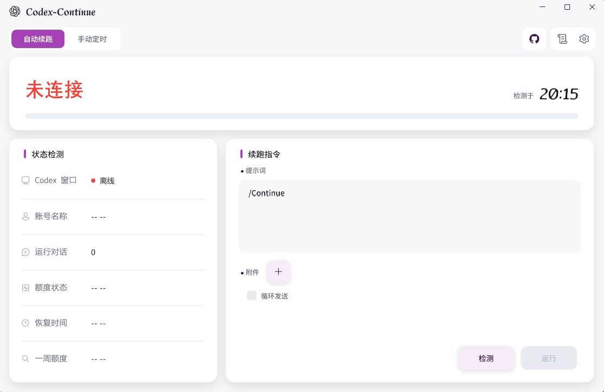

<p align="center">
  <picture>
    <source media="(prefers-color-scheme: dark)" srcset="docs/logo-dark.svg">
    
  </picture>
</p>

<h1 align="center">Codex-Continue</h1>

<p align="center">Codex-Continue 是一款面向 Windows 平台的 Codex 自动化续跑工具。Codex 额度耗尽并恢复后，它会自动向指定对话发送继续指令，全程无需人工值守。</p>

<p align="center">
  
</p>

## 主要功能

- **实时额度监测**：直连 Codex app-server 读取额度，并设 rollout 与 UIA 双回退通道；离线状态如实呈现- **自动续跑**：捕捉额度「用尽 → 恢复」的跃迁自动发送指令（默认 `/continue`，可自定义）；一轮仅发送一次，可开启循环守护直至手动停止
- **手动定时**：于指定时刻发送一次，支持按预计恢复时刻 ±5 分钟微调
- **对话与指令**：选择目标对话、编辑多行提示词、附件路径随文发送
- **桌面体验**：现代扁平界面；浅色 / 深色 / 跟随系统主题；中英双语；系统托盘与单实例运行；自适应窗口布局与 PerMonitorV2 DPI
- **自动更新**：启动时后台检查 GitHub Releases，新版本于右下角提示；下载校验文件大小与 SHA256，不自动执行安装包

## 获取与安装

前往 [Releases](../../releases) 页面下载 `Codex-Continue.exe`。软件包为 Windows x64 自包含单文件，无需安装 .NET 运行时，下载后即可运行。

若系统 SmartScreen 给出提示（程序尚未签名），选择「更多信息」→「仍要运行」即可继续。

## 使用指引

1. 启动 Codex。额度检测与指令发送均依赖其正常运行。
2. 启动 Codex-Continue，连接页将自动探测并进入主界面。
3. 选择目标对话并编写提示词（默认 `/continue`），点击「运行」开启自动守护；亦可使用「手动定时」执行单次发送。
4. 窗口可收至托盘持续守护，托盘菜单提供 Open、Settings、Run、Stop 与 Exit。

## 从源码构建

环境要求：Windows、[.NET 9 SDK](https://dotnet.microsoft.com/download/dotnet/9.0)。

```sh
cd src
dotnet publish -c Release -r win-x64 --self-contained true -p:PublishSingleFile=true -o ../publish
```

构建产物为 `publish/Codex-Continue.exe`，改名由构建脚本自动完成。

> 注意：修改 XAML 后须清理 `src/obj` 与 `src/bin` 再行构建。增量缓存可能导致改动不进入产物且不产生报错。

## 项目结构

| 目录 | 说明 |
|---|---|
| `src/` | WPF 应用本体（.NET 9，零 NuGet 依赖） |
| `tests/` | 回归检查（DetectionFrequency.Tests） |
| `probe/` | 开发期 UI 探测与验证脚本 |
| `docs/superpowers/plans/` | 功能设计计划 |
| `_tools/` | 图标生成等辅助脚本 |

## 许可证

本项目基于 [MIT License](LICENSE) 开源发布。

第三方组件：[Octicons](https://github.com/primer/octicons)（MIT License），许可全文见 `src/Notices/Octicons-LICENSE.txt`。
